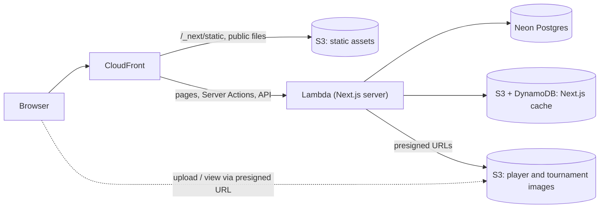

# TennisDB

[](https://github.com/rageagainsttheMS/tennis-db/actions/workflows/deploy.yml)

**Live site: https://d2t2gio7o197fi.cloudfront.net**

TennisDB is a full-stack web app for exploring professional men's tennis statistics. It holds match-level data from the 2024 ATP season, about 2,800 matches from Brisbane in January to the ATP Finals in November, together with curated player and tournament profiles. You can search for a player or tournament, open a player's profile and match history, see every match played at a tournament, and look at the serve and break point statistics for a single match.

This is a hobby project. It runs on serverless AWS infrastructure defined in code, and every change is tested and deployed by GitHub Actions.

## Features

- **Public browsing.** Anyone can search, and view player profiles, tournaments and match statistics. No account is needed.
- **Search on the home page.** Players and tournaments have separate tabs, and suggestions update as you type, with a short delay so a query isn't sent on every keystroke.
- **Player profiles.** Each profile shows the player's bio (country, birthplace, year turned pro, playing hand, backhand style, current ranking) and every match they played, whether they won or lost.
- **Tournament pages.** Each page shows the tournament's details (category, surface, draw size) and all of its matches, which you can filter by round.
- **Match details.** Each match page compares the winner and loser side by side: aces, double faults, first serve %, points won on first and second serve, break points saved/faced, service games, and match length.
- **Admin pages.** Admins sign in with Google (Auth.js v5) to create and edit players and tournaments and to upload their images. Admins are listed in the `ADMIN_EMAILS` environment variable.
- **Light and dark themes**, using Chakra UI and `next-themes`.

## Tech stack

| Area | Technology |
| --- | --- |
| Framework | Next.js 16 (App Router, Server Actions, Turbopack), React 19, TypeScript |
| UI | Chakra UI v3, React Icons |
| Database | PostgreSQL on Neon (serverless), connected with `@prisma/adapter-neon` |
| ORM | Prisma 7 |
| Validation | Zod |
| Auth | Auth.js / NextAuth v5 (Google OAuth, JWT sessions) |
| Testing | Vitest (unit, Server Action and CDK tests), Playwright (end-to-end) |
| Infrastructure | AWS CDK with `cdk-nextjs`: Lambda, CloudFront, S3, DynamoDB |
| CI/CD | GitHub Actions: lint, type-check, tests, then deploy on every push to `main` |

## Architecture



- **Hosting.** [cdk/stack.ts](cdk/stack.ts) defines one CDK stack. `cdk-nextjs`'s `NextjsGlobalFunctions` builds the app with the Next.js Deployment Adapter API and deploys it as a zip Lambda behind CloudFront. The Next.js cache lives in S3 and DynamoDB. There's no VPC, so there are no fixed monthly costs, and the stack runs for roughly $0–1 a month at hobby traffic.
- **Data access.** Every database read and write is a Server Action in [lib/actions/](lib/actions/), and they all share one Prisma client set up in [db/prisma.ts](db/prisma.ts).
- **Security.** Server Actions are public HTTP endpoints, so every action that changes data checks for an admin session on the server (`requireAdmin()` in [lib/utils/auth-guards.ts](lib/utils/auth-guards.ts)) and validates its input with Zod ([lib/validation/](lib/validation/)). [proxy.ts](proxy.ts) and the admin layout also keep non-admins out of `/admin`. Image uploads go straight from the browser to a private S3 bucket through short-lived presigned URLs. Only admins can get one, and each URL is limited to one image of an allowed type and size, with a key the server chooses.
- **Linking data.** Matches are connected to players and tournaments by their IDs in the source dataset. `Player.playerMatchId` is matched against `Match.winnerId` and `Match.loserId`. When you create a tournament in the admin pages, the app finds that tournament's `tourneyId` by looking up its name in the imported matches.

## Data model

There are three models, defined in [prisma/schema.prisma](prisma/schema.prisma):

- **Player**: bio and profile information entered through the admin pages, including playing hand (`LEFT`/`RIGHT`), backhand style (`ONEHANDED`/`TWOHANDED`), ranking, and image.
- **Tournament**: name, category (`GS`, `ATPM1000`, `ATP500`, `ATP250`, `DavisCup`, `LaverCup`), surface, draw size, and image.
- **Match**: a single match from the dataset. It includes tournament information, both players' entry details (seed, rank, age, height, country), the score, the round, the match length in minutes, and the full serve statistics for both players. In the database, the columns keep the source CSV's snake_case names (`w_ace`, `l_bpFaced`, and so on), and Prisma maps them to camelCase fields.

## Testing

The tests run in CI on every pull request and before every deploy.

**Unit tests (Vitest)**, in [tests/](tests/):
- Serve-statistic calculations ([lib/stats/match-stats.ts](lib/stats/match-stats.ts)), including missing stats and divide-by-zero cases.
- Zod input validation, including fields a client must not be able to set.
- Admin and auth guards, and the S3 key checks that block path traversal.
- The upload and image-URL API routes: non-admins get a 401, and bad file types, sizes and folders are refused.
- Server Actions with Prisma mocked. Non-admins are rejected **before** any database call, and database errors never reach the client.
- CDK assertions on the images bucket: no public access, encrypted, versioned, no wildcard CORS, and an unchanged logical ID so a deploy can't replace it.

**End-to-end tests (Playwright)**, in [e2e/](e2e/). These are smoke tests against the production build (`next start`): the health route, the public home page and search tabs, the sign-in page, the admin redirect for anonymous visitors, and the not-found page. They don't need a database, so they run in CI as they are. The same tests can run against the live site.

**After each deploy**, the workflow checks the live site's health route and a page that reads from the database.

```bash
npm test                 # unit tests
npm run test:watch       # unit tests in watch mode
npm run test:coverage    # unit tests with a coverage report
npm run build && npm run test:e2e                                   # e2e against a local production build
E2E_BASE_URL=https://d2t2gio7o197fi.cloudfront.net npm run test:e2e  # e2e against the live site
```

Run `npx playwright install chromium` once before the first e2e run.

## Project structure

```
app/                  Next.js App Router pages
  page.tsx            Home page with player and tournament search
  profile/[id]/       Player profile
  tournament/[id]/    Tournament details
  match/[id]/         Match statistics
  admin/              Admin-only pages for creating and editing players and tournaments
  signIn/             Sign-in page
  api/                Auth.js routes, image upload/view URLs, health check
components/ui/        Feature components (tables, details views) and shared header/menu
lib/actions/          Server Actions for matches, players, and tournaments
lib/stats/            Pure statistics functions (serve stats)
lib/validation/       Zod schemas for Server Action input
lib/utils/            Auth guards, admin list, S3 helpers
db/                   Prisma client and the CSV import script
prisma/               Schema and migrations (prisma.config.ts holds the CLI config)
generated/prisma/     Generated Prisma client (gitignored; created by `prisma generate`)
cdk/                  AWS CDK stack and the images bucket
tests/                Vitest unit, Server Action and CDK tests
e2e/                  Playwright end-to-end tests
proxy.ts              Next.js proxy (middleware) protecting /admin
auth.ts               Auth.js configuration
```

## Getting started

### Prerequisites

- Node.js 22 or later
- A Neon (or any other PostgreSQL) database
- A Google OAuth client ID and secret

### Environment variables

Create a `.env` file. The Prisma CLI reads `DATABASE_URL` from `.env` only, not from `.env.local`.

```bash
DATABASE_URL="postgresql://..."
AUTH_SECRET="..."              # generate with: npx auth secret
AUTH_GOOGLE_ID="..."
AUTH_GOOGLE_SECRET="..."
ADMIN_EMAILS="you@example.com" # comma-separated; if unset, nobody is an admin
AWS_S3_BUCKET_NAME="..."       # optional locally; only needed for image uploads
```

In the Google Cloud Console, add `http://localhost:3000/api/auth/callback/google` as an authorised redirect URI for local sign-in.

### Install and run

```bash
npm install                  # also generates the Prisma client
npx prisma migrate deploy
npm run db:seed              # import Match.csv
npm run dev
```

The app runs at http://localhost:3000.

### Match data

`npm run db:seed` runs [db/importMatches.ts](db/importMatches.ts), which loads `Match.csv` from the project root. For a faster bulk load with `psql`, see the `\copy` command in [prisma/commands.txt](prisma/commands.txt).

Players and tournaments are not in the CSV. Add them through the admin pages.

## Deployment

[.github/workflows/deploy.yml](.github/workflows/deploy.yml) deploys to AWS region `ap-southeast-2`:

1. **checks**: lint, type-check and unit tests.
2. **e2e**: production build and Playwright smoke tests.
3. **deploy**: runs only if both pass. It runs `cdk synth` (which builds the app), then on pushes to `main`, `cdk deploy`, then the post-deploy smoke test. Pull requests stop after `cdk synth`.

The deploy job writes the app's runtime settings to `.env.production` from these repository secrets, and cdk-nextjs packages that file into the Lambda:

| Secret | Purpose |
| --- | --- |
| `DATABASE_URL` | Neon connection string |
| `AUTH_SECRET`, `AUTH_GOOGLE_ID`, `AUTH_GOOGLE_SECRET` | Auth.js and Google OAuth |
| `ADMIN_EMAILS` | Admin accounts |
| `AWS_ACCOUNT_ID`, `AWS_ACCESS_KEY_ID`, `AWS_SECRET_ACCESS_KEY` | AWS deploy credentials |

**Deploy from Linux or macOS.** A build made on Windows writes a backslash path into Next.js's server config (`cacheHandler` in `required-server-files.json`), and the Lambda then fails every request. Use GitHub Actions or WSL to deploy. To deploy by hand from a Linux or macOS machine with AWS credentials:

```bash
npx cdk deploy
```

[docs/improvements-and-deployment.md](docs/improvements-and-deployment.md) has the full redeploy checklist and cost notes.

## Scripts

| Command | Description |
| --- | --- |
| `npm run dev` | Start the development server |
| `npm run build` | Generate the Prisma client and create a production build |
| `npm run start` | Serve the production build |
| `npm run lint` | Run ESLint |
| `npm run typecheck` | Type-check with `tsc --noEmit` |
| `npm test` | Run the unit tests |
| `npm run test:watch` | Run the unit tests in watch mode |
| `npm run test:coverage` | Run the unit tests with a coverage report |
| `npm run test:e2e` | Run the Playwright end-to-end tests |
| `npm run db:seed` | Import `Match.csv` into the database |
| `npm run deploy` | Deploy to AWS with CDK (from Linux or macOS) |
